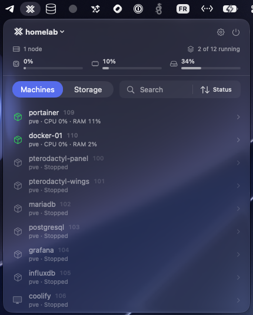
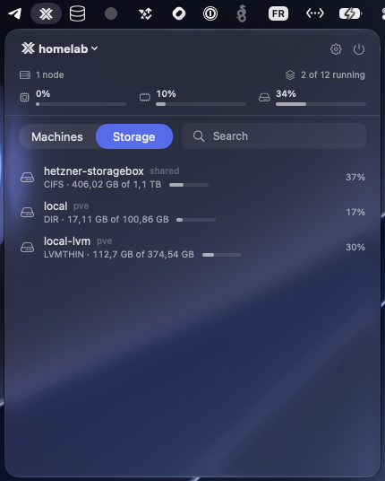

# ProxmoxBar

Monitor your Proxmox VE servers and control VMs and containers from the macOS menu bar.

[Mac App Store](https://apps.apple.com/app/proxmoxbar/id6800746122) · [Download DMG](https://github.com/ryzenixx/proxmoxbar-macos/releases/latest) · [Source](#build-from-source)

<p align="center">
  
  
</p>

## What it does

- Switch between servers and check node health, CPU, memory and storage.
- Search and sort VMs and containers. Start, shut down, restart, force stop or resume them from the panel.
- Get notifications for guest and node status changes across your servers.
- Add a desktop widget for a server, or show cluster CPU or the running guest count in the menu bar.

## Install

ProxmoxBar runs on **macOS 15 or later**. The App Store edition updates through the store. The direct download is signed and notarized and uses Sparkle for updates.

To install the direct edition with Homebrew:

```sh
brew install --cask ryzenixx/tap/proxmoxbar
```

## Connect a server

Enter your server's HTTPS address, token ID and token secret. A typical address is `https://pve.example.net:8006` and a token ID looks like `proxmoxbar@pve!menubar`. If macOS asks for local network access, allow it so the app can reach your server.

### Create a restricted API token

In the Proxmox VE web interface:

1. Under **Datacenter → Permissions → Roles**, create a role named `ProxmoxBar` with the privileges below.
2. Under **Users**, create `proxmoxbar` in the Proxmox VE authentication server realm. Assign the role to that user at `/` with **Propagate** enabled.
3. Under **API Tokens**, create a token for `proxmoxbar@pve`. With **Privilege Separation** enabled, grant the token the same role and scope. Alternatively, disable separation to inherit the dedicated user's permissions.
4. Copy the secret when Proxmox shows it. ProxmoxBar uses the token for API requests and stores the secret in the macOS Keychain.

| Privilege | Used for |
| --- | --- |
| `VM.Audit` | Reading VM and container state |
| `VM.PowerMgmt` | Running power actions |
| `Sys.Audit` | Reading node status |
| `Datastore.Audit` | Reading storage usage |

### Verify the certificate

A default Proxmox VE certificate is signed by the cluster's own CA. If macOS does not recognize it, ProxmoxBar shows its SHA-256 fingerprint before you connect. Compare the fingerprint with the certificate on the node you intended to add, using a trusted connection.

## Build from source

Open [ProxmoxBar.xcodeproj](ProxmoxBar.xcodeproj) in **Xcode 27 or later**, select **ProxmoxBar**, then press **⌘R**. Xcode resolves Sparkle through Swift Package Manager. Use **ProxmoxBar MAS** for the App Store build.

[Contributing](CONTRIBUTING.md) · [Privacy](PRIVACY.md) · [Security](.github/SECURITY.md) · [MIT License](LICENSE)
